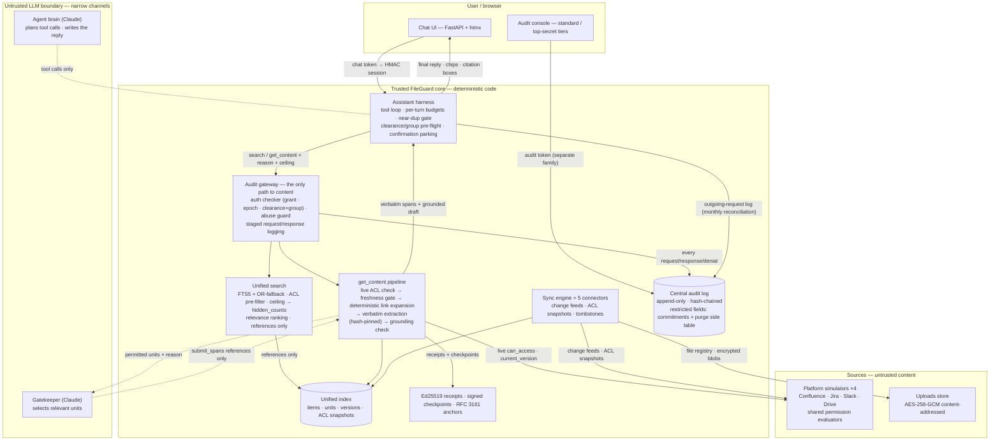
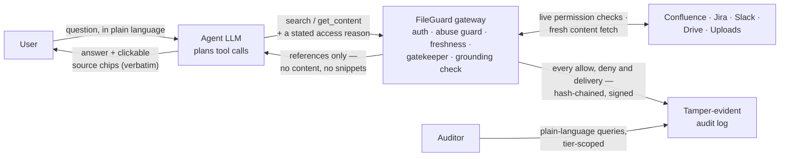

# Architecture & Trust Boundaries

FileGuard (Internal Brain) sits between an LLM assistant and a company's
knowledge across four platforms (Confluence, Jira, Slack, Google Drive —
simulated) plus an uploaded-file store. The agent never reads raw content:
discovery is a permission-filtered reference list, retrieval is a
server-side pipeline that selects, extracts, verifies and *then* delivers —
and every allow, deny and delivered span is recorded in a tamper-evident
audit log.

## Trust model

- **Trusted code (deterministic)**: the web UI, harness tool loop, audit
  gateway, auth checker, abuse guard, connectors, sync engine, unified
  index, search, extractor, grounding check, audit log, checkpoints, the
  harness-local audit log.
  Everything security-relevant happens here; no LLM is ever in the
  authorization path.
- **Untrusted LLMs (narrow channels)**: the *agent brain* (plans tool
  calls, writes the final reply — sees only references and delivered
  spans) and the *Gatekeeper* (selects relevant units — sees only
  permitted content and may only answer with span references).
- **Untrusted data**: all platform/document content. It is pre-filtered
  before any model sees it, delimited as untrusted, and grounded after.

## Diagram

### Simplified view

The same system in six boxes — the whole story on one line per arrow:

Read it as three guarantees: the agent sees **references** until a full
permission pipeline has run; the user receives **verbatim** delivered
spans it can re-check via the chips; and the auditor sees **everything
that happened** — including every refusal. And the audit trail is
double-recorded: the harness keeps its own local hash-chained log of
every outgoing request, reconciled against the central chain monthly, so
tampering would have to fool both logs at once.

## Trust boundaries and their controls

| # | Crossing | What crosses | Control |
|---|---|---|---|
| 1 | Browser → chat UI | chat token | HMAC-signed session cookie; UI is presentation-only |
| 2 | Harness → gateway | scoped grant, access reason, desired ceiling, search terms (committed) | grant signature + expiry, permission-epoch gate, clearance ceiling (OVERCLEARANCE), group AND-gating, abuse guard; reason hardened (length/charset); request+response logged as a chained pair |
| 3 | Index → agent (search) | references only: id, title, platform, container, label, counts | ACL pre-filter on snapshots + effective per-item rating; ceiling demotion → `hidden_counts` (counts only ever cover items the user is already authorized to open, withheld because the agent chose a lower ceiling — under-clearance users get no trace of anything); forbidden ≡ non-existent responses; stopword-filtered OR fallback; relevance ranking |
| 4 | Index/pipeline → Gatekeeper | permitted candidate units + access reason | output constrained to `submit_spans` references, validated against existing units (can only narrow); deterministic code-built input; fail-closed on LLM error |
| 5 | Pipeline → harness/agent | verbatim, hash-pinned spans + grounded draft | live ACL re-check (authoritative) → freshness gate → deterministic link expansion (each hop re-checked) → extraction hash-pinned to item version → confirmation gate (secret: once/session; top secret: single-use nonce, grant re-minted) → grounding check (unproven sentences never delivered) → delivery-shape classification (excerpt / stitched / no content) → signed delivery receipt |
| 6 | Document content → any model | untrusted text | permission-filtered before any model sees it; delimited as untrusted in prompts; injection fixtures in the test suite; grounding check deletes unproven sentences |
| 7 | Agent → user | final reply, chips, citation boxes | chips state the delivery shape (excerpt / stitched / no content); citation boxes show the delivered verbatim text; receipts bind delivered spans to the audit entry |
| 8 | Sims → connectors | change feeds, ACL snapshots, content | bearer-token auth against a seeded directory; shared unit-tested permission evaluators; live `can_access` on fresh ACLs is authoritative at query time |
| 9 | Anything → audit log | append-only entries | DB triggers make UPDATE/DELETE impossible; hash chain; restricted fields as salted-hash commitments (plaintext in a purge-able side table; purge itself audited); harness keeps a second, local hash-chained log of every outgoing request, **reconciled monthly** against central (`scripts/reconcile.py` — a mismatch appends a `reconciliation_flag` entry); drift (`policy_mismatch`) warnings on overlay/platform disagreement |
| 10 | Chat ↔ audit console | two token families | non-interchangeable; standard tier sees routine entries + reduced violations; secret+ accesses hidden entirely; top-secret tier resolves restricted fields |

## Component inventory

| Component | Trusted? | Deterministic? | Role |
|---|---|---|---|
| `ui/web.py` (chat, upload, sources, audit console) | trusted | — | presentation only; sessions are HMAC cookies |
| `harness/agent_loop.py` | trusted code hosting an **untrusted** LLM | no (live brain) | tool loop, budgets, near-dup gate, pre-flight checks, confirmation parking, local log |
| `fileguard/gateway.py` | trusted | yes | the chokepoint: auth → abuse → route → log |
| `fileguard/auth_checker.py` / `session_service.py` | trusted | yes | grants, epoch, clearance+group AND-gating, nonces |
| `fileguard/abuse_guard.py` | trusted | yes | rate/volume/pattern caps, decaying windows |
| `fileguard/search.py` | trusted | yes | FTS5 retrieval over the permission-filtered index |
| `fileguard/pipeline.py` | trusted | yes (dispatches LLMs) | the get_content flow; fail-closed everywhere |
| `fileguard/grounding.py` | trusted | yes | sentence-level verification of the composed draft |
| `fileguard/connector.py` + `connectors/*` | trusted | yes | normalised access to sources; `can_access` on fresh ACLs |
| `fileguard/sync_engine.py` | trusted | yes | change feeds → index; tombstones; lag tracking |
| `fileguard/db.py` + `audit_restricted.py` | trusted | yes | append-only hash-chained logs; commitments + purge |
| `fileguard/security.py` / `checkpoint.py` | trusted | yes | HMAC grants, AES-256-GCM store, Ed25519 receipts/checkpoints, RFC 3161 anchors |
| `simulators/*` + `evaluators.py` | trusted (content untrusted) | yes | the four platforms; shared permission evaluators |
| agent brain (Claude) | **untrusted** | no | tool-call planning; final reply wording |
| Gatekeeper (Claude / TF-IDF stub) | **untrusted** (stub deterministic) | stub yes / live no | span selection, references only |
| answering composition (stub) | deterministic stub | yes | extractive draft over delivered spans; feeds the grounding check |

## Key trade-offs

1. **Search lives inside the gateway.** Unscoped search *is* the leak;
   scoped, reason-asserted, capped search is not. References-only results
   plus forbidden ≡ non-existent responses close the metadata side-channel.
2. **Two-stage access control.** A cheap ACL pre-filter on snapshots ranks
   candidates; an authoritative live check against fresh platform ACLs
   decides. Snapshots are an optimization, never the final word.
3. **The Gatekeeper can only narrow.** It receives permitted units and
   answers in references; the worst it can do (even under injection) is
   select a permitted-but-irrelevant span.
4. **Extractive-only delivery with a grounding check.** Content is
   delivered verbatim and hash-pinned; composed answers are checked
   sentence-by-sentence, unproven sentences are dropped, and what the
   user receives is classified by delivery shape (excerpt / stitched /
   no content) rather than trusted.
5. **Deterministic stubs for the LLM channels in CI.** The full test suite
   (350+ tests) runs offline and fast; live LLM modes are a dispatch away
   (per-Gatekeeper-mode) with identical contracts, so swapping stub → live
   changes no security property.
6. **Restricted audit fields as commitments.** Raw prompts, search terms
   and answers are stored as salted hashes in the chain with plaintext in
   a purge-able side table — purging keeps the chain verifiable, and
   reconciliation compares commitments only.
7. **Per-item transactions over batching.** Every `get_content` is one
   audited, receipt-bound security transaction (live check, freshness,
   confirmation, extraction); the per-turn budget bounds volume instead of
   amortising checks away.
8. **Overlay narrows, never elevates.** Native platform permission is
   required first and is terminal; the clearance/group overlay can only
   remove access — and disagreements are audited as `policy_mismatch`
   warnings (stale policy or platform misconfiguration detection).
9. **Fail closed, uniformly.** Gatekeeper errors, freshness failures,
   unknown items and denied permissions all produce the same generic
   response; a denied document and a missing one are indistinguishable by
   design.
10. **Simulators over live APIs.** The four platforms are stateful
    simulators with the real permission semantics extracted into shared,
    unit-tested evaluators; live APIs can replace them behind the same
    connector contract without touching the trust model.
